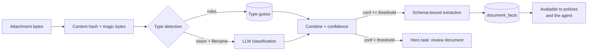
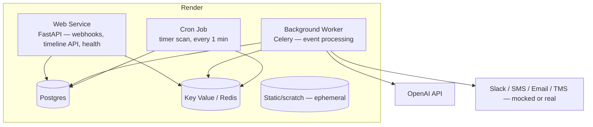

# Proposal — Freight Ops Agent

**A design proposal for the AI Engineer System Design Assessment (freight broker load agent).**

Status: **Proposal / pre-implementation**. This document is the blueprint. Every architectural
decision below is stated with its rationale and will be expanded into a numbered ADR in
`docs/adr/` as the code is written.

---

## Table of contents

1. [Executive summary](#1-executive-summary)
2. [The problem, restated](#2-the-problem-restated)
3. [Proposed architecture](#3-proposed-architecture)
4. [Architecture decisions (ADR index)](#4-architecture-decisions-adr-index)
5. [Component design](#5-component-design)
6. [The assessment scenario, step by step](#6-the-assessment-scenario-step-by-step)
7. [SOP organization and retrieval](#7-sop-organization-and-retrieval)
8. [Memory model](#8-memory-model)
9. [Document understanding](#9-document-understanding)
10. [Cost model](#10-cost-model)
11. [Latency budget](#11-latency-budget)
12. [Scaling plan](#12-scaling-plan)
13. [Evaluation strategy](#13-evaluation-strategy)
14. [Deployment on Render](#14-deployment-on-render)
15. [Repository layout](#15-repository-layout)
16. [Scope: what is built and what is not](#16-scope-what-is-built-and-what-is-not)
17. [Implementation roadmap](#17-implementation-roadmap)
18. [Risks and open questions](#18-risks-and-open-questions)

---

## 1. Executive summary

The system is an **event-driven agent** that watches a freight load, decides what to do under the
broker's Standard Operating Procedure (SOP), and either acts on its own or escalates to a human.

The core architectural bet is this:

> **Separate the *decision* from the *wording*. Most of the decision can be computed; only the
> fuzzy judgement calls need an LLM.**

Concretely, the proposal is a **hybrid of a deterministic policy engine and an LLM agent**, joined by
a single durable event log:

```
Event ──▶ LoadState (deterministic fold over the event log)
            │
            ├──▶ Compiled Policy (SOP → executable steps)  ──▶ deterministic steps + LLM *gates*
            │
            └──▶ LLM Fallback Agent (ReAct with tools)  ──▶ for situations no policy covers
                        │
                        ▼
                 Action (idempotent, logged, replayable) ──▶ Integration adapters
```

Why this shape wins for *this* problem:

| Requirement | How this design meets it |
| --- | --- |
| 5-minute run budget | Policy path has no LLM call at all in the common case; the fallback agent is capped at N tool iterations and a wall-clock deadline. |
| ~$1 LLM cost per load | Outbound wording is **templated**, not generated. The LLM is used for classification/extraction on short inputs with a cheap model (`gpt-6-luna`, $0.10/$0.50 per MTok). Projected spend: **$0.03–$0.08 per load**. |
| SOPs editable by non-technical people | SOPs stay Markdown. Policy steps live in a fenced, schema-validated block inside the same file, with a copy-paste template and a one-command validator. |
| "The agent must know when **not** to act" | A first-class **do-not-act gate** runs before any action. Absence of a matching policy, or a gate that returns "not actionable", produces `no_action` — an explicit, logged, testable outcome. |
| Unknown situations | The fallback agent handles them, and every fallback decision is captured as a **candidate SOP** for a human to promote. Unknown situations become known ones. |
| Auditable | Every action records *which SOP clause*, *which state predicate*, and *which LLM judgement* caused it. There is a per-load timeline API that reads like a story. |

The "hybrid" is the central idea, so it deserves a short justification, because the two obvious
alternatives are both wrong for this problem:

- **Pure LLM agent (ReAct over SOP prose).** Flexible, but every run re-reads and re-interprets
  prose. It cannot reliably count "two SMS with no ETA" (the exact rule in the assessment), it
  cannot be regression-tested cheaply, and its cost/latency are unbounded.
- **Pure rules engine.** Cheap and deterministic, but the assessment explicitly says *we do not know
  all situations before they occur*. A rules engine cannot handle the novel case; it can only fail.

The hybrid keeps the rules engine for the 80% of traffic that is already known, and reserves the LLM
for the parts where language ambiguity lives — while still being able to handle the unknown 20%.

---

## 2. The problem, restated

Working in the vocabulary of the assessment:

- A **load** moves through stages: `dispatched → to_pickup → at_pickup → to_delivery → at_delivery →
  delivered` (repeating per stop for multi-stop loads).
- **Events** arrive: email (main thread), SMS (driver), Slack (broker staff), location pings, timers
  the agent itself armed, and attachments (BOL / POD / rate confirmation / receipts).
- **Actions** go out: external (SMS, email, Slack, TMS note, follow-up timer) and internal (Hero
  task, load stage/status update, internal Slack alert).
- **The SOP is the law.** 60–70% is shared across clients; the rest is per client, sometimes per
  load type. Non-technical people edit it. New clients arrive constantly.

Three properties of this problem drive the whole design:

1. **The interesting state is temporal.** "Send an SMS; if no ETA after 30 minutes, send it again;
   after two with no ETA, escalate." This is a small state machine with a counter and a deadline.
2. **The SOP is a control policy, not a knowledge base.** We are not answering questions from it;
   we are *executing* it. This is the single most important observation in the assessment, and it
   is what makes the deterministic-policy approach possible.
3. **Silence is a valid signal.** "No ETA after 30 minutes" is evidence, and "the driver said 'ok'
   when we asked nothing" is a *do-nothing* case. The agent must be able to conclude "nothing to do."

---

## 3. Proposed architecture

### 3.1 System diagram

```mermaid
flowchart LR
    subgraph Sources[External sources]
        E[Email thread]
        S[SMS from driver]
        K[Slack from broker]
        P[Location ping]
        D[Attachment]
    end

    subgraph Edge[Edge — Render Web Service]
        R[FastAPI webhook receivers]
        R -->|append| EV[(events table)]
        R -->|enqueue| Q{{Redis / Celery queue}}
    end

    subgraph Core[Core — Render Background Worker]
        W[Event processor]
        W --> FOLD[State folder<br/>derive LoadState]
        FOLD --> RES[SOP resolver<br/>base → client → load-type]
        RES --> PE[Policy engine<br/>(deterministic steps + LLM gates)]
        PE -->|no policy matched| FA[LLM fallback agent<br/>(tool-calling loop)]
        FA --> PE
        PE --> AX[Action executor<br/>idempotency key + outbox]
    end

    subgraph Store[State]
        DB[(Postgres<br/>events, actions, timers, llm_calls)]
        SOP[(SOP Markdown<br/>base + client overrides)]
    end

    subgraph Out[Effects]
        SMS[Adapter: SMS]
        EM[Adapter: Email]
        SL[Adapter: Slack]
        TMS[Adapter: TMS]
        HERO[Adapter: Hero tasks]
    end

    subgraph Timers[Render Cron Job — 1 min tick]
        T[Due-timer scan] -->|synthetic timer.fired event| W
    end

    Sources --> R
    W --> DB
    SOP --> RES
    PE --> DB
    AX --> Out
    AX --> DB
    T --> DB
```

### 3.2 The run loop

One *agent run* = one event → zero or more actions.

```
1. RECEIVE    Event arrives (webhook or timer tick) → persisted, deduplicated by provider id
2. FOLD       Recompute LoadState = fold(state_snapshot, new_events)
3. MATCH      situation = (event_type, stage, load_type, signals)
              policy = resolve_policy(client, situation)      # base → client → client+load_type
4. DECIDE     if policy found:  run policy steps
              else:             run fallback LLM agent
5. EXECUTE    each due step → idempotent action + state effect + outbox row
6. RECORD     action, rationale, LLM calls (tokens/cost) → timeline
```

Steps 2–3 are pure functions of (event log, SOP). Step 4's *gates* are the only LLM calls on the
hot path, and they are narrow: "does this message contain an ETA?", "is this a question?", "is this
document a BOL?".

### 3.3 Why the state is a fold, not a table of columns

`LoadState` is derived by replaying the event log. This single choice answers three of the
assessment's questions at once:

- *"How does the agent know its past actions and the past messages of the load?"* — They **are** the
  event log. There is no separate memory system to keep in sync, and no way for memory to disagree
  with history.
- *"At 07:13, how does the agent remember that the ETA request is still open?"* — The ETA request is
  a first-class object in `LoadState.open_requests`, opened by a state effect when the first SMS was
  sent and closed only by a gate that *detects an ETA*. The driver's question at 07:12 does not close
  it, because the gate returned `has_eta: false`.
- *"How does a follow-up timer work?"* — A timer is a row in `timers` with a `request_key`. When it
  fires it becomes a synthetic event carrying that key, so the engine re-enters the same decision
  path with full context instead of running a special-case code path.

For performance we keep a materialized snapshot (`load_states`) so the fold is
`snapshot + tail`, not a full replay. That is an optimization, not the source of truth — the
assessment's 2-week/100-message load is small enough to replay in full during development, and the
replay path is what the eval harness uses.

---

## 4. Architecture decisions (ADR index)

Each row becomes `docs/adr/NNNN-<slug>.md` with Context / Decision / Consequences / Alternatives.

| # | Decision | Rationale | Alternative rejected |
| --- | --- | --- | --- |
| 001 | Record decisions as ADRs in `docs/adr/` | The assessment explicitly asks for documented architectural decisions; ADRs are the standard, reviewable format. | A single "Design" prose doc — hard to review a single change. |
| 002 | Hybrid: deterministic policy engine + LLM fallback agent | Meets the 5-minute and $1 budgets while still handling unknown situations (assessment: "we do not know all situations before they occur"). | Pure ReAct agent (cost/latency/counter-unreliability); pure rules engine (cannot handle novelty). |
| 003 | Event-sourced load state; state is a fold over the log | Makes "memory of past actions and messages" a property of the architecture rather than a prompt-engineering trick. Answering an open ETA request becomes a data-structure question. | Mutable state table (drift, no replay, harder debugging). |
| 004 | Outbound messages are **templates**, not LLM prose | Cost, latency, tone consistency, and auditability. A freight SMS is formulaic; generating it is waste. | Free-form LLM drafting for every message (≈10× cost, non-deterministic tone, unauditable). |
| 005 | LLM is used as a **classifier/extractor** behind typed gates, not as the decision-maker on the hot path | Gates are small, schema-validated, and cheap to test. The escalation ladder ("two SMS with no ETA") becomes a counter in code, not a sentence the model must honour. | Letting the model count attempts from conversation history. |
| 006 | Layered SOP resolution: `base → client → client+load_type`, keyed by `policy_key` | Matches the assessment's 60–70% shared / per-client / per-load-type structure and makes client changes surgical (override one clause, not a copy of the manual). | Copy-and-edit a full SOP per client (diverges, unmaintainable); one giant merged document per client (expensive to retrieve, hard to diff). |
| 007 | SOP files are Markdown **with** YAML front matter and an optional fenced `policy` block | Non-technical editors keep writing prose; machine-checkable steps live next to the prose that explains them; the schema validator gives them a safe editing loop. | Pure prose (non-deterministic, expensive); pure YAML/DSL (hostile to non-technical editors, no room for nuance). |
| 008 | Policy metadata filter → BM25 → embedding rerank → top-K | Metadata filtering removes 95% of the corpus for free; only the remainder pays for embeddings. Uses Postgres FTS + `text-embedding-3-small` ($0.02/MTok). | Pure vector search (fails on exact-match metadata like `stage: at_pickup`); pure keyword (misses paraphrases). |
| 009 | Model tiering: `gpt-6-luna` default → `gpt-6.1-sol` escalation → `gpt-6-astra` frontier, with a hard per-load budget guard | Meets the ~$1/load requirement with a 10× margin on the default tier while keeping a capability path for hard cases. | Single flagship model (over budget); single nano model (falls apart on novel situations). |
| 010 | Prompt caching on the stable prefix (system + SOP excerpt + load context) | `gpt-6-luna` cached input is $0.01/MTok vs $0.10 — 90% cheaper, and the stable prefix is exactly what we resend every run. | No caching (paying full price for identical context). |
| 011 | Long-thread compaction: last N messages verbatim + rolling summary of the rest | A 2-week load accumulates 50–100 messages; unbounded context would blow the cost budget and the latency budget. | Full history in every prompt (cost/latency grow with load age). |
| 012 | DB-backed timers + a 1-minute cron scan | Predictable, restart-safe, inspectable, and queryable ("what is scheduled for this load?"). A timer is state, not a magic queue entry. | Celery ETA tasks (opaque, zombie-task management, harder to inspect). |
| 013 | At-least-once delivery with an idempotency key per action | Webhooks and email providers retry. Duplicate SMS to a driver is a real-world incident, not a theoretical one. | At-most-once (silent message loss); exactly-once (not achievable without distributed transactions). |
| 014 | Transactional outbox for effects; adapters are the only things that talk to the outside world | Keeps the core testable with zero external calls, and lets us run the whole system offline. | Direct calls from the engine (untestable, non-replayable). |
| 015 | Mock integrations behind a stable adapter interface | The assessment allows mocks; the interface + contract tests mean real Twilio/Slack/TMS adapters drop in without touching the engine. | Building real integrations (out of scope, adds cost, no design insight). |
| 016 | Python 3.12+, FastAPI, Pydantic v2, SQLAlchemy 2, Celery + Redis, Postgres | Best-in-class OpenAI SDK, async web framework, strong typed-schema support for structured outputs. Matches Render's documented background-worker stack. | TypeScript (fine, but weaker structured-output/eval ergonomics); Go (faster but slower to iterate). |
| 017 | Deploy to Render: Web Service + Background Worker + Cron Job + Postgres + Key Value | Render's documented topology for exactly this shape of workload; `render.yaml` blueprint makes it one-command reproducible. | AWS (more moving parts than the assessment requires — it explicitly says AWS is optional); single-process Docker (no isolation between ingest and processing). |
| 018 | Use the OpenAI **Responses API** with structured outputs (strict JSON schema) | Single API for tools + structured output + reasoning-effort control + background mode if we later need it. | Chat Completions (migrating away); Assistants API (deprecated direction). |
| 019 | Fallback-agent decisions are captured as **candidate SOPs** for human promotion | Closes the loop from "novel situation" to "known situation" and gives the non-technical SOP editors a concrete, reviewable work queue. | Letting the fallback agent silently write to the live SOP (dangerous, unauditable). |
| 020 | Every action stores its rationale (SOP clause id, predicate, LLM decision, model, tokens) | "The agent does some tasks alone and shows what it did" is an explicit requirement, and it is also what makes the eval harness able to assert *why*, not just *what*. | Log-only (not queryable, not assertable). |

---

## 5. Component design

### 5.1 Domain model

```python
# Canonical event envelope — every input becomes one of these.
class Event(BaseModel):
    id: UUID
    load_id: str
    type: Literal["email", "sms", "slack", "location_ping", "timer_fired", "attachment"]
    source_contact_id: str | None       # driver / dispatcher / broker
    channel: str                        # sms / email / slack
    occurred_at: datetime               # when it happened in the world
    received_at: datetime               # when we learned about it
    thread_id: str | None               # main email thread
    body: str | None
    attachment_ids: list[str]
    payload: dict                       # type-specific (lat/lng/delay_risk, timer context, ...)
    provider_event_id: str              # dedupe key
```

```python
# Derived state — a fold over the event log.
class LoadState(BaseModel):
    load_id: str
    client_id: str
    load_type: str | None               # e.g. "refrigerated" — drives load-type overrides
    stage: str
    delay_risk: str                     # low / medium / high
    stops: list[Stop]
    facts: dict[str, str]               # PO number, gate code, contact names...
    open_requests: dict[str, OpenRequest]
    contact_channels: dict[str, set[str]]
    last_inbound_at: datetime | None

class OpenRequest(BaseModel):
    key: str                            # "eta"
    kind: str                           # "eta" | "temperature" | "seal" | ...
    status: Literal["open", "answered", "cancelled"]
    attempts: int                       # how many times we asked
    opened_at: datetime
    last_asked_at: datetime | None
    deadline_at: datetime | None        # when the next escalation is due
    responses_seen: int
    answered_at: datetime | None
```

`open_requests` is the crux of the memory question. An ETA request is opened by a **state effect**
when the first SMS goes out, and closed by a **gate** when an inbound driver message is classified
as containing an ETA. The driver's question at 07:12 does not close it.

### 5.2 Policy format

An SOP file is Markdown. Front matter carries the retrieval metadata. The optional fenced
`policy` block carries the executable steps.

````markdown
---
policy_key: delay_risk.high
title: High delay risk — driver ETA
scope: base                       # base | client | client_load_type
stage: [to_pickup, to_delivery]
situations: [delay_risk_high]
event_types: [location_ping, timer_fired]
load_types: [any]
priority: 50
version: 3
effective_from: 2026-09-01
---

## What to do when the delay risk becomes high

The driver is the cheapest source of an updated ETA, so ask the driver first. Do not contact
the dispatcher before we have asked the driver twice — the dispatcher will not have better
information than the driver, and early escalation erodes trust.

```policy
- id: ask_driver_first
  when:
    delay_risk: high
    no_open_request: eta
  do:
    action: send_sms
    to_role: driver
    template: ask_eta
  effect:
    open_request: {key: eta, kind: eta}
  also:
    - {action: set_timer, request_key: eta, after_minutes: 30}

- id: ask_driver_again
  when:
    open_request: {key: eta, attempts: 1, elapsed_since_last_ask_minutes: ">=30"}
  do:
    action: send_sms
    to_role: driver
    template: ask_eta
  effect:
    increment_attempts: eta
  also:
    - {action: set_timer, request_key: eta, after_minutes: 30}

- id: escalate_to_dispatcher_and_hero
  when:
    open_request: {key: eta, attempts: ">=2", elapsed_since_last_ask_minutes: ">=30"}
  do:
    action: send_email
    to_role: dispatcher
    in_thread: main
    template: dispatcher_no_eta
  also:
    - {action: create_hero_task, template: call_driver_for_eta, urgent: true}
```
````

**Predicates** (`when:`) are evaluated in Python against `LoadState`. They are deliberately a tiny
vocabulary — no arbitrary expressions, no eval. Supported forms: field equality, field comparison,
`no_open_request`, `open_request` with attempt/age constraints, `never_acted`, `stage`, `load_type`.

**Gates** are optional LLM classifiers attached to a step, evaluated *before* the step's `do`:

```yaml
- id: close_request_if_eta_received
  gate:
    name: message_signals
    description: "Classify the inbound driver message."
    input: {message: "$last_inbound_message"}
    output_schema: MessageSignals
  when:
    last_inbound_from: driver
  do:
    action: no_action
  effect:
    close_request_if: {key: eta, when: "$gate.has_eta"}
```

**Actions** (`do:` / `also:`) are one of: `send_sms`, `send_email`, `send_slack`, `tms_note`,
`set_timer`, `create_hero_task`, `update_load_stage`, `internal_slack`, `no_action`.

**Templates** are separate Markdown files under `templates/`, also overridable per client. This
keeps wording out of the policy logic and makes per-client tone changes trivial.

### 5.3 Client override example

Client B's rule is the same situation with a different escalation target. Because resolution is
keyed by `policy_key`, Client B overrides only what differs:

`sops/clients/client_b/delay-risk-high.md`

````markdown
---
policy_key: delay_risk.high
scope: client
client_id: client_b
inherits: base
version: 1
---

Client B does not want the dispatcher contacted. We alert the broker in Slack instead.

```policy
- id: escalate_to_dispatcher_and_hero
  replaces: escalate_to_dispatcher_and_hero
  do:
    action: send_slack
    to_channel: broker
    template: broker_delay_alert
  also:
    - {action: internal_slack, template: hero_delay_alert}
```
````

The `replaces:` key swaps that one step; the `ask_driver_first` and `ask_driver_again` steps are
inherited from base unchanged. A per-load-type override (`client_b` + `refrigerated`) layers on top
and wins again. **Client onboarding for a client that only differs in a few places is a handful of
short Markdown files.**

### 5.4 The LLM gateway

One choke point for every model call.

```python
class ModelTier(str, Enum):
    FAST      = "fast"       # gpt-6-luna        — classification, extraction, drafting fallback
    BALANCED  = "balanced"   # gpt-6.1-sol       — escalated decisions, ambiguous classification
    FRONTIER  = "frontier"   # gpt-6-astra       — rare, hard reasoning; budget-guarded
```

Responsibilities:

- **Tier selection** — automatic from the call site, with explicit override.
- **Structured output** — every call declares a Pydantic model; the SDK's strict JSON-schema mode
  guarantees shape; a validator retries once on shape failure.
- **Prompt caching** — the stable prefix (system prompt + SOP excerpt + load context) is placed
  first and marked for caching.
- **Cost accounting** — tokens and dollars recorded per call, aggregated per load, surfaced in the
  timeline API and guarded by a per-load budget.
- **Retries and degradation** — bounded exponential backoff; on repeated failure the run degrades to
  template-only behaviour and escalates to a Hero (never silently drop).
- **Redaction** — phone numbers and addresses are replaced with contact IDs before the prompt leaves
  the process; the message service resolves IDs back to addresses. This matches the assessment's
  "the agent identifies each person with a contact ID" and avoids putting PII in model logs.

### 5.5 Action execution and idempotency

```python
action_key = sha256(f"{load_id}|{policy_key}|{step_id}|{attempt}|{event_id}")
```

- `action_key` has a unique index in `actions`. A repeated insert is a no-op → the effect is sent
  exactly once even though ingestion is at-least-once.
- The action row stores: `type`, `target`, `rendered_body`, `template_id`, `rationale` (SOP clause,
  predicate result, gate output), `llm_calls` (ids), `cost_usd`, `status`.
- Effects go through an **outbox** table; a dispatcher worker drains it to the adapters. This makes
  the engine fully testable offline and gives a clean retry seam.

### 5.6 Integration adapters

```python
class IntegrationAdapter(Protocol):
    async def send_sms(self, contact_id: str, body: str, idempotency_key: str) -> str: ...
    async def send_email(self, contact_id: str, subject: str, body: str,
                         thread_id: str | None, idempotency_key: str) -> str: ...
    async def send_slack(self, channel: str, body: str, idempotency_key: str) -> str: ...
    async def tms_note(self, load_id: str, note: str, idempotency_key: str) -> str: ...
    async def create_hero_task(self, load_id: str, title: str, body: str,
                               urgent: bool, idempotency_key: str) -> str: ...
```

v1 ships `MockAdapter` (writes to the `sent_messages` table + structured log) and a `RecordingAdapter`
that captures calls for the eval harness. Real adapters are a documented seam, not a rewrite.

---

## 6. The assessment scenario, step by step

Client A. Procedure: *send an SMS to the driver for the ETA; if no ETA after 30 min, send it again;
after two SMS with no ETA, email the dispatcher in the main thread, then create a Hero task.*

| Time | Event | State after fold | Decision | Action |
| --- | --- | --- | --- | --- |
| 07:00 | Location ping, `delay_risk: low → high` | `delay_risk=high`, no open request | Policy `delay_risk.high` step `ask_driver_first` matches (`no_open_request: eta`) | `send_sms` to driver (template `ask_eta`); open request `eta` (attempts=1); `set_timer` eta+30m → 07:31 |
| 07:01 | *(agent's own SMS, logged as an action)* | — | — | — |
| 07:12 | SMS from driver: *"What's the PO number?"* | `delay_risk=high`, request `eta` still open | Gate `message_signals` → `{has_eta: false, is_question: true, topic: "po_number", confidence: 0.96}`. Policy `driver.question` matches → resolve `PO 55821` from `load.facts` / `load.instructions` | `send_sms` to driver: *"PO 55821."* **Request `eta` stays open** (the gate did not detect an ETA, so nothing closed it) |
| 07:31 | Timer `eta` fires | request `eta` open, attempts=1, 30 min elapsed | Step `ask_driver_again` matches (`attempts: 1`, elapsed ≥ 30) | `send_sms` to driver (template `ask_eta`); attempts=2; `set_timer` → 08:01 |
| 08:01 | Timer `eta` fires | request `eta` open, attempts=2, 30 min elapsed since last ask | Step `escalate_to_dispatcher_and_hero` matches (`attempts ≥ 2`, elapsed ≥ 30) | `send_email` to dispatcher in main thread (template `dispatcher_no_eta`); `create_hero_task` (urgent) |
| 08:02 | — | — | — | (actions recorded with full rationale) |

Three things in this trace are worth calling out, because they are where a naive agent fails:

1. **The 07:12 message must not count as an ETA.** A model asked "did the driver give an ETA?"
   will sometimes say yes to "10 min" or to a bare time-like string. The gate returns
   `has_eta: false` because the message contains no time and expresses a *question*. Only a gate
   result with `has_eta: true` closes the request.
2. **Answering the PO question must not advance the ladder.** The ladder advances only on timer
   events, and only by the `attempts` counter. Answering a question is a separate policy
   (`driver.question`) with its own action.
3. **"No ETA" is evidence of absence, tracked structurally.** The request is open; the timers are
   armed against that open request; the escalation fires because the request is *still* open after
   the second timer. The system never has to reason about "the driver didn't answer" in prose.

### 6.1 The do-nothing case (required by the assessment)

> *"the driver sends 'ok', but the agent did not ask a question. The correct action is to do nothing."*

Trace:

| Time | Event | Decision |
| --- | --- | --- |
| 09:14 | SMS from driver: *"ok"* | Gate `message_signals` → `{kind: "acknowledgement", has_eta: false, is_question: false}`. No open request. Policy `driver.ack_unprompted` matches with `do: no_action`. |

The do-nothing path is reached two ways, and both are explicit and logged:

- **A policy that says do nothing.** The SOP explicitly covers "unsolicited acknowledgement" →
  `no_action`. The decision is *recorded*, not merely absent.
- **No policy and no useful signal.** The fallback agent runs, and its tool schema includes
  `no_action` as a first-class tool with a required `reason`. If the agent does not act, the reason
  is stored and reviewed. `no_action` is a valid, complete outcome — not a failure.

Additionally, a **do-not-act gate** sits in front of every outbound action:

```
if not should_respond(event, target_role):
    → log no_action(reason="no_open_request_awaiting_this_contact")
```

For example: the SOP says "email the dispatcher", but the inbound event came *from* the dispatcher
answering a question we did not ask. Replying would be noise. This gate is evaluated before
dispatch, is cheap, and is itself covered by eval cases.

### 6.2 Client B and the load-type variant

The same machinery covers the assessment's other two examples with no code change:

| Client | Situation | Result |
| --- | --- | --- |
| Client B | `delay_risk_high` | Inherits base steps 1–2. Step 3 is overridden: `send_slack` to the broker instead of `send_email` to the dispatcher. No dispatcher contact, as the SOP demands. |
| Client B, `refrigerated` load | Driver leaves the pickup | Load-type-scoped policy: `send_sms` to driver asking for trailer temperature **and** seal number. Layers on top of the client override. |

---

## 7. SOP organization and retrieval

### 7.1 Layout

```
sops/
├── base/                        # The standard procedure (60–70% shared)
│   ├── delay-risk-high.md
│   ├── driver-question.md
│   ├── driver-ack-unprompted.md
│   ├── pickup-arrival.md
│   └── delivery-pod.md
├── clients/
│   ├── client_a/                # Client A's overrides
│   │   ├── delay-risk-high.md
│   │   └── templates/
│   ├── client_b/
│   │   ├── delay-risk-high.md
│   │   └── load_types/
│   │       └── refrigerated/
│   │           └── driver-leaves-pickup.md
├── templates/                   # Message wording (base + per-client overrides)
└── schema/
    ├── policy.schema.json        # JSON Schema for front matter + policy blocks
    └── sop-authoring-guide.md    # For the non-technical editors
```

### 7.2 Resolution order

```
effective_policy(client, load_type, situation)
  = base[situation]
    ◦ overridden by client[client_id][situation]
    ◦ overridden by client[client_id][load_type][situation]
```

Overrides are applied **per step id**, not per file: an override file may `replace` one step,
`patch` fields on a step, or `disable` a step, while inheriting the rest. This is what makes
onboarding a new client cheap and what makes "Client B only differs here" expressible without
duplicating the base.

### 7.3 Retrieval

Two different retrieval jobs, deliberately separated:

| Job | Method | Cost |
| --- | --- | --- |
| **Find the policy to execute** (fast path) | Structured SQL query on front matter: `policy_key`, `scope`, `stage`, `situation`, `load_type`, `version`, `effective_from ≤ now` | Free |
| **Find the SOP prose to reason over** (fallback agent) | Metadata filter → Postgres FTS (BM25) → `text-embedding-3-small` rerank → top-K chunks | ~$0.002 per query |

**Advantages**: metadata filtering makes exact-match situations (which is most of them) free and
precise; the fallback path still handles paraphrase and novel situations; the retrieval result is
cacheable per (client, situation, load_type, policy_version).

**Disadvantages**: the metadata taxonomy is a design burden — a new situation type requires a
taxonomy change, which requires an AI engineer. Mitigated by (a) letting the front matter be
extended without code changes, (b) falling back to the embedding path when the structured query
returns nothing, and (c) the candidate-SOP queue (decision 019), which surfaces
"we keep hitting situations we have no policy for" as a work item for the SOP editors.

### 7.4 Making non-technical editing safe

The requirement is that *an AI engineer must not be necessary to change an SOP*. The design:

1. **Same file format for every client.** Markdown with front matter. No build step, no code, no
   schema authoring for new clients.
2. **Copy-paste templates.** `sops/schema/templates/` holds a ready-to-fill file per common
   situation, with the `when` conditions written in plain English above each predicate. The editor
   edits prose and small values; the predicates are chosen from a documented list.
3. **A validator the editors can run.** `make sop-check` validates every SOP file against
   `policy.schema.json`: front matter present and well-formed, `policy_key` unique per scope,
   action names valid, templates exist, step ids unique, predicate vocabulary known. It prints
   plain-English errors. It runs in CI and can be run locally.
4. **A dry-run preview.** `make sop-preview --client client_b --situation delay_risk_high` prints
   the *resolved, merged* policy and the resulting action sequence, so an editor sees exactly what
   their file does before it goes live. This is the safety net that removes the need for an AI
   engineer in the loop.
5. **Versioned and reversible.** Every SOP file is versioned in git with `effective_from`. A change
   to Client A's procedure cannot silently alter Client B's, because overrides are scoped.
6. **Change-time evaluation.** A PR that edits SOP files triggers the eval harness against the
   affected client suites plus the shared base suite, and reports a diff of expected vs actual
   actions. The editor sees "you changed 1 behaviour; 14 test cases still pass" without writing
   code.
7. **The candidate queue.** Unknown situations surface as candidate SOPs — pre-filled with the
   situation, the trace, and a proposed policy — so the editor's job is to edit, not to author
   from scratch.

This is the design, not the build. We build the validator, the preview command, the CI wiring, and
the candidate queue; we do not build a web editor. That is recorded in
[Section 16](#16-scope-what-is-built-and-what-is-not).

---

## 8. Memory model

| Memory | Where it lives | Why |
| --- | --- | --- |
| **Past actions** | `actions` table + the event log | The agent's own history is a first-class, queryable ledger. "What did I already do?" is a SQL query, not a prompt recap. |
| **Past messages** | `events` table (email/SMS/Slack), compacted for prompting | Full fidelity is retained; only the *prompt* is compacted. |
| **Working state** | `LoadState` — a fold over the log | Derived, so it can never disagree with history. |
| **Open requests / counters** | `LoadState.open_requests` | The "ETA request is still open" question becomes a field lookup. |
| **Load facts** | `load.facts` + `load.instructions` | Where the PO number at 07:13 came from. |
| **Semantic recall** | Postgres FTS + `text-embedding-3-small` index over messages | For "the last time this driver complained about X" style questions, used by the fallback agent. |
| **Long-term summary** | Rolling summary row per load | Keeps prompt size bounded over a 2-week load (decision 011). |

### 8.1 Answering the three memory questions directly

**Q: How does the agent know its past actions and the past messages of the load?**
The event log. Every inbound message and every outbound action is an event. `LoadState` is a fold
over that log, and the fold is exposed to the decision layer as structured fields.

**Q: At 07:13, how does the agent remember that the ETA request is still open?**
The request was opened by a *state effect* when the 07:01 SMS was sent, and it is closed only by a
gate that detects an ETA. The 07:12 message produced `{has_eta: false}`, so the request was not
closed. At 07:13 the state still contains `open_requests["eta"] = {status: "open", attempts: 1}`.
Note what this buys us: "still open" is a fact, not an inference, so the escalation ladder cannot be
skipped by a chatty model.

**Q: How does a follow-up timer work? What does the agent see when the timer starts it?**
A timer is a durable row (`load_id`, `request_key`, `reason`, `fires_at`, `status`). A 1-minute cron
scan selects due timers and appends a synthetic `timer_fired` event whose payload carries the
context: `{request_key: "eta", opened_at, attempts, last_asked_at, elapsed_minutes: 30, reason:
"no ETA after first request"}`. The timer does not call the agent directly — it *feeds the agent
the same way any other event does*, so the timer path and the message path share one decision
engine, one set of policies, and one audit trail.

---

## 9. Document understanding

Attachments are BOL, POD, rate confirmations, and receipts, as photos or PDFs. The pipeline:



**Type detection** is three cheap signals combined:
1. **Magic bytes / container sniffing** — is it a PDF, JPEG, PNG, HEIC? (deterministic)
2. **Filename heuristics** — `BOL_481207.pdf`, `POD_scan.jpg` (deterministic)
3. **Visual LLM classification** — "which of these document types is this?" with a fixed label set
   and a confidence score.

Confidence is combined; above threshold we proceed, below it we create a Hero task saying
"unrecognized document on load 481207" rather than guessing. This is a deliberate
**abstention-first** design: a wrong document type silently corrupts downstream decisions, while a
Hero task costs one minute of someone's time.

**Key-value extraction** is schema-bound per document type:

```python
class BillOfLading(BaseModel):
    bol_number: str | None
    pro_number: str | None
    scac: str | None
    shipper: str | None
    carrier: str | None
    commodity: str | None
    weight_lbs: int | None
    seal_number: str | None
    pickup_date: date | None
    signed: bool
    confidence: float
```

Extraction uses a vision model with **strict JSON schema output** against this schema, then a
Pydantic validation pass. A second pass validates cross-document consistency (e.g. the POD's
trailer number matches the BOL's). Results are cached by content hash, so a re-sent photo costs
nothing.

**Why not OCR + rules?** Because the documents are photos of handwritten forms, and because a
schema-bound VLM call is both simpler and cheaper than building and maintaining an OCR pipeline
for four document types.

---

## 10. Cost model

### 10.1 Model pricing used (OpenAI, October 2026)

| Model | Input / MTok | Cached input / MTok | Output / MTok | Role in this design |
| --- | --- | --- | --- | --- |
| `gpt-6-luna` | $0.10 | $0.01 | $0.50 | **Default tier** — classification, extraction, fallback agent |
| `gpt-6.1-sol` | $2.00 | $0.10 | $10.00 | **Escalation tier** — ambiguous classification, hard decisions |
| `gpt-6-astra` | $10.00 | $1.00 | $50.00 | **Frontier tier** — rare, budget-guarded |
| `text-embedding-3-small` | $0.02 | — | — | SOP retrieval rerank |

### 10.2 Per-load projection

Assumptions: 100 events per load (the stated upper bound), 50 inbound messages, a 2-week lifetime,
5 attachments.

| Workload | Calls/load | Tokens per call (in/out) | Model | Cost/load |
| --- | --- | --- | --- | --- |
| Message classification gate (`message_signals`) | ~100 | 1,200 / 60 | luna | $0.015 |
| Template rendering of outbound messages | 0 | — | — | **$0.000** (templated) |
| Fallback LLM agent (novel situations) | ~8 | 9,000 / 900 | luna | $0.012 |
| Escalations to `gpt-6.1-sol` (~2% of decisions) | ~2 | 6,000 / 600 | sol | $0.026 |
| Frontier tier (<0.5% of decisions) | ~0.2 | 8,000 / 800 | astra | $0.010 |
| Document classification + extraction | ~5 | 2,500 / 400 | luna | $0.002 |
| Embeddings (SOP retrieval + semantic recall) | ~100 | 400 / — | emb-3-small | $0.001 |
| **Total** | | | | **≈ $0.066** |

**Target is $1.00. Projection is $0.066 — a ~15× margin.** The margin is not idle: it is what
absorbs the 10× volume growth, the escalation tier, the frontier tier, and prompt-cache misses
during a cache rollover.

### 10.3 The levers, in order of impact

1. **Template the outbound wording (decision 004).** The single biggest lever. Generating an SMS
   costs ~500× more than rendering one and buys nothing in reliability. If we generated every
   message with the frontier model, the same workload would cost ~$1.30/load — over budget.
2. **Cheap default model (decision 009).** `gpt-6-luna` at `reasoning_effort: none` for
   classification is 100× cheaper than the frontier tier.
3. **Prompt caching (decision 010).** The stable prefix is ~70% of every prompt. At $0.01/MTok
   cached, this saves ~$0.01–0.02/load.
4. **Thread compaction (decision 011).** A 2-week load with 100 messages would otherwise carry
   ~40k tokens of history into every call. Compaction caps it at ~8k.
5. **Structural gating.** Because the escalation ladder is code, the model is never asked to count
   attempts — the most common source of both cost and errors.
6. **Batch / Flex API for non-latency-critical work.** Retroactive document extraction and eval runs
   are 50% cheaper on the Batch API and are not on the 5-minute path.
7. **Hard per-load budget guard.** If a load exceeds a configured dollar threshold (say $0.50), the
   system degrades to template-only behaviour (no fallback agent) and raises a Hero task. Cost
   becomes a bounded failure mode rather than a surprise.

### 10.4 Cost monitoring

Every call is recorded with model, tokens, cached-token count, and dollars. `GET /loads/{id}/cost`
returns the breakdown. A dashboard aggregates per client, per policy, and per tier, so an
unusual SOP (one that causes 20 fallback-agent runs per load) is visible before it reaches 10,000
loads.

---

## 11. Latency budget

Requirement: **one agent run ≤ 5 minutes, from the event to the last action, including
infrastructure.**

| Phase | Budget (p95) | Notes |
| --- | --- | --- |
| Webhook receipt → persisted + queued | 100 ms | Postgres insert + Redis enqueue |
| Queue wait → worker pickup | 1 s | Celery, prefetch tuned |
| State fold (snapshot + tail) | 50 ms | Full replay is <100ms even at 500 events; used in dev/evals |
| SOP resolution | 20 ms | Indexed lookup |
| LLM gate (fast tier, `reasoning_effort: none`) | 2 s | The dominant cost on the hot path |
| Fallback agent (≤ 6 tool iterations) | 25 s | Only on the uncovered path |
| Action execution + outbox | 200 ms | Mock adapters are instant; real adapters are async and off the critical path |
| **Total, fast path** | **~3.5 s** | |
| **Total, fallback path** | **~30 s** | |
| **Total, worst case (frontier tier + retries)** | **~90 s** | |

**Headroom is deliberate.** The 5-minute budget is enforced as a **run deadline** (default 240 s):
the engine tracks elapsed time and, if a run approaches the deadline, it stops starting new work,
executes what it has, and escalates to a Hero with a full trace. This guarantees the SLO
*structurally* rather than hoping the model is fast.

A second SLO component: **the webhook endpoint returns 202 immediately** and does the work
asynchronously. The 5-minute budget is measured from the event timestamp, not from the HTTP
response — the endpoint is never the bottleneck.

---

## 12. Scaling plan

### 12.1 Current volume

100,000 loads/month ≈ 3,300/day ≈ 140/hour. With 50–100 events per load, that is roughly
**7,000–14,000 events/hour ≈ 2–4 events/second average**, with US business hours peaks perhaps
**20–30 events/second**. Concurrent active loads at any moment: ~1,500.

This is a modest workload. A single Render worker instance with a modest Postgres handles it with
room to spare. **The 10× case is a design constraint on v1, not a v1 implementation task** — the
architecture must not have a 10× blocker in it.

### 12.2 What must change at 10× (1M loads/month, ~40 events/s peak)

| Concern | v1 | At 10× |
| --- | --- | --- |
| Ingestion | Single FastAPI instance | Multiple instances behind Render's LB; webhooks are already stateless |
| Queue | Redis (Render Key Value) | Redis Cluster or a managed queue (SQS/SQS-FIFO); Celery stays, broker swaps |
| Processing | 1–2 worker instances | Autoscale worker instances on queue depth; partition tasks by `load_id` to avoid contention |
| Event storage | Single Postgres | Monthly partitions on `events` by `occurred_at`; BRIN index on `timers.fires_at`; read replica for the timeline API |
| State fold | Snapshot + tail, recomputed per event | Incremental per-load worker (a load's events always route to the same partition), so the fold becomes an O(1) update |
| Timers | 1-minute cron scan over `timers` | Partitioned scan with a due-time index; or a Redis sorted-set timer wheel, still with a DB mirror for durability |
| LLM cost | $0.066/load | Tiering matters more: push all classification to `gpt-6-luna` with `reasoning_effort: none`; cap the fallback agent; consider Flex processing for non-urgent work |
| Retrieval | Postgres FTS + in-process embedding cache | Dedicated vector index (pgvector) or a managed vector store |
| Evaluation | Nightly full suite | Tiered: fast deterministic suite on every PR, live-LLM suite nightly, sampled production shadowing |

**No 10× blocker exists in v1.** The two things that would have been blockers — state folding
(which is O(1) with a snapshot) and timer scanning (which is index-friendly) — are designed for
incrementalization from day one.

### 12.3 Production safety mechanisms

- **Shadow mode.** New policies and new model versions run in shadow for a sample of loads,
  producing decisions that are logged but not executed. Divergence rate is a dashboard.
- **Kill switch per client.** A config flag disables autonomous action for a client; the system
  then only records what it *would* have done. (Essential in an industry where a wrong SMS to a
  driver is a service failure.)
- **Circuit breaker on the LLM.** If error rates spike, the system degrades to template-only
  behaviour and raises Hero tasks rather than stalling.
- **Dead-letter queue.** Events that repeatedly fail processing go to a DLQ with a replay command.
- **Every action is reversible/compensatable** where the action type allows (e.g. a mistaken
  Slack alert can be retracted by a follow-up message).

---

## 13. Evaluation strategy

The assessment asks for evals that "show the agent takes the correct action at each step of the
situation", including a case where the correct action is to do nothing, plus four questions about
production confidence.

### 13.1 Scenario format

```yaml
# evals/scenarios/load_481207_client_a_high_delay.yaml
id: load_481207_client_a_high_delay
client: client_a
load: fixtures/load_481207.json
description: The assessment scenario, Client A, high delay risk.

steps:
  - at: "2026-10-13T07:00:00-07:00"
    event: {type: location_ping, payload: {delay_risk: high, lat: 37.9, lng: -121.2}}

    expect:
      actions:
        - {type: send_sms, to_role: driver, template: ask_eta}
        - {type: set_timer, request_key: eta, after_minutes: 30}
      state:
        open_requests:
          eta: {status: open, attempts: 1}

  - at: "2026-10-13T07:12:00-07:00"
    event: {type: sms, from: driver, body: "What's the PO number?"}

    expect:
      actions:
        - {type: send_sms, to_role: driver, body_contains: "55821"}
      state:
        open_requests:
          eta: {status: open, attempts: 1}     # <-- the request must STILL be open
      notes: "The driver asked a question, not gave an ETA. The ladder must not advance."

  - at: "2026-10-13T07:31:00-07:00"
    event: {type: timer_fired, payload: {request_key: eta, elapsed_minutes: 30}}

    expect:
      actions:
        - {type: send_sms, to_role: driver, template: ask_eta}
        - {type: set_timer, request_key: eta, after_minutes: 30}
      state:
        open_requests:
          eta: {status: open, attempts: 2}
```

The assertion vocabulary is deliberately about **observable behaviour** — action type, target,
template, and the resulting state — not about prompt internals. A scenario can assert
`no_action` explicitly:

```yaml
  - at: "2026-10-13T09:14:00-07:00"
    event: {type: sms, from: driver, body: "ok"}
    expect:
      actions: []
      no_action: {reason_matches: "unsolicited_acknowledgement"}
```

### 13.2 Test layers

| Layer | Needs an LLM? | Runs when | Purpose |
| --- | --- | --- | --- |
| **L0 — Policy unit tests** | No | Every PR | Each predicate, action, and state effect in isolation. Fast, free. |
| **L1 — Deterministic scenario replay** | No (gates stubbed from recorded fixtures) | Every PR | Full timelines with recorded gate outputs. Catches policy and state bugs. |
| **L2 — Live-LLM scenarios** | Yes | Nightly + pre-release | The same scenarios against the real API. Measures real gate accuracy. |
| **L3 — Production shadow** | Yes | Continuous, sampled | Compares live decisions against the deployed policy on real traffic. |
| **L4 — Cost & latency assertions** | Partly | Nightly | Enforces the $1/load and 5-minute budgets as *tests*. |

**Recorded fixtures** are the key to keeping CI cheap: every LLM call in L1 is replayed from a
recorded fixture, so the suite is deterministic and free. L2 re-runs those same scenarios live to
detect drift between the fixture and reality.

### 13.3 Answering the four eval questions

**Q1: How do you make sure the system works correctly in production?**
Four mechanisms, in increasing order of trust:
1. **Golden timelines.** Every load scenario has an expected action sequence. The assessment
   scenario is the first golden timeline; each new SOP situation adds one.
2. **Shadow mode before release.** A new policy or model version runs in shadow on real traffic and
   its decisions are compared to the live ones. Divergence is reviewed by a human before the
   version is promoted.
3. **Per-client promotion.** Policies ship per client, behind a flag, with a kill switch. A new
   client starts in `shadow` for a few days.
4. **Post-hoc auditability.** Because every action records its rationale, any incident can be
   reconstructed exactly: which policy, which clause, which gate output, which model version.
   An unexpected action is a query, not an investigation.

**Q2: A client changes its procedure. How do you make sure other behavior does not break?**
- **Scoped resolution.** Overrides are namespaced by client and load type, so a change to
  `client_a/delay-risk-high.md` cannot alter `client_b`. The resolver is unit-tested for this
  isolation property specifically.
- **Change-aware test selection.** CI diffs the changed SOP files, maps them to `policy_key`s, and
  runs (a) the affected client's suites, (b) the shared base suite, and (c) a **blast-radius
  report** — "this change can affect situations X, Y, Z for clients A and B" — so the reviewer
  sees the impact before merging.
- **Snapshot testing of resolved policies.** Each client/situation pair has a committed snapshot of
  its *resolved* policy. A change that silently alters an unrelated client's resolved policy fails
  the snapshot test. This is the strongest guard against cross-client leakage.
- **The base suite is shared and always runs.** A client override that breaks the base behaviour
  fails loudly.

**Q3: You change the LLM. How do you make sure the system does not break?**
- **Pin and version the model.** Model IDs are config, never hard-coded; every call records the
  exact model and version used, so a mixed population is visible.
- **Run L2 against the new model and compare to the recorded baseline.** The gate outputs are
  compared field-by-field against the baseline (not just pass/fail): a change in the `has_eta`
  distribution is the single most important signal, because it directly moves the escalation
  ladder.
- **Specific regression tests for the dangerous flips:**
  - `has_eta` must stay `false` for "What's the PO number?" (the 07:12 case).
  - `has_eta` must stay `true` for "I'll be there at 14:30" and for "around 2pm".
  - `is_question` must be `true` for "What's the PO number?".
  - `kind == "acknowledgement"` for "ok", "sure", "yes".
- **LLM-as-judge for free text.** Outbound message quality (does the SMS actually ask for the ETA?
  is it under 320 characters? is the tone acceptable?) is judged by a rubric, scored on a sample.
- **A promotion gate.** The new model must score ≥ the baseline on the golden set, with no
  regression in the no-action false-positive rate, before it is promoted. The comparison runs
  offline against the Batch API (50% cheaper).
- **Instant rollback.** Model ID is a config change; the previous model stays available and the
  switch is a redeploy.

**Q4: Clients have different procedures and different complexity. How do you organize the evals?**
- **Three axes, and the suite layout mirrors them.** Suites are organized by
  `(scope, client, situation, load_type)`:
  ```
  evals/suites/
  ├── base/                 # shared behaviour — every client must satisfy these
  ├── clients/client_a/    # client-specific overrides
  ├── clients/client_b/
  ├── load_types/refrigerated/
  ├── negative/            # do-nothing cases, always applicable
  └── contracts/           # adapter + schema contracts
  ```
- **Coverage is measured, not assumed.** A coverage report maps every `policy_key` × client ×
  load_type to the scenarios that exercise it. Any uncovered combination is a visible gap in CI.
- **Complexity is handled by inheritance, not duplication.** A complex client reuses the base
  scenarios and adds only its deltas. The base suite is written once and run for every client —
  which is exactly how the shared 60–70% of the SOP is protected.
- **The base suite is executed against every client's resolved policy**, so a client override that
  breaks shared behaviour fails immediately.
- **Negative suites are first-class.** The do-nothing suite is not a subset of the happy-path
  suite; it runs against every client, because "when not to act" is the behaviour most likely to
  regress silently.

---

## 14. Deployment on Render

> **This section describes the target topology.** What ships today is smaller: the
> stores are in-memory, so they belong to a process, so the API and the timer
> scan run in one container and the blueprint in `render.yaml` declares one
> service. The topology below is what the blueprint grows into when the
> Postgres stores land, and it is kept there as a comment. See
> [ADR-017](adr/0017-render-topology.md) and `docs/RUNNING.md`.

### 14.1 Topology



| Render service | Type | Command | Notes |
| --- | --- | --- | --- |
| `freight-api` | Web Service | `uvicorn freight_agent.api.app:app --port $PORT` | Stateless; receives webhooks; returns 202 fast |
| `freight-worker` | Background Worker | `celery -A freight_agent.workers.celery_app worker -l info` | Consumes the event queue |
| `freight-timers` | Cron Job | `python -m freight_agent.workers.timer_tick` | Scans due timers, enqueues `timer_fired` events |
| `freight-db` | Postgres | managed | Event log, state, actions, timers |
| `freight-kv` | Key Value (Redis) | managed | Celery broker |

All of it is declared in a `render.yaml` blueprint, so the whole environment is reproducible with
one command and reviewable in a PR.

### 14.2 Configuration

All secrets via environment variables, injected by Render:
`OPENAI_API_KEY`, `DATABASE_URL`, `REDIS_URL`, `WEBHOOK_SECRET`, `SOP_DIR`, `LLM_TIER_FAST_MODEL`,
`LLM_TIER_BALANCED_MODEL`, `LLM_TIER_FRONTIER_MODEL`, `RUN_DEADLINE_SECONDS`,
`PER_LOAD_BUDGET_USD`.

### 14.3 Deploy caveats worth documenting

- **Render Cron Jobs have a minimum period of 1 minute.** Our timer scan is 1 minute, so the
  worst-case lateness of a timer is ~60 s. The escalation ladder (30-minute windows) tolerates
  this comfortably; a 1-minute SOP window would not. Documented as a known constraint.
- **Background workers on Render are long-lived processes** that scale by instance count, not by
  queue depth automatically. Autoscaling therefore requires either a fixed instance count or a
  supervisor that reads queue depth. Documented; v1 uses a fixed count sized for the stated volume.
- **Render Postgres has a connection limit.** Celery workers each hold a pool; we use a small
  `pool_size` per worker and `NullPool` for the web service's health checks to avoid exhausting
  connections.
- **Cold starts.** The web service should not do any LLM work on a request path, so cold starts
  stay fast and cheap.
- **Local development must not require Redis or Postgres.** The eval harness runs entirely against
  SQLite + an in-process fake queue, so `make evals` works on a laptop with one command.

### 14.4 Local development

| Command | What it does |
| --- | --- |
| `make install` | Install with `uv` (falls back to `pip`) |
| `make eval` | Run the deterministic eval suite — no API key, no network |
| `make eval-live` | Run the same suite against the real model (needs `OPENAI_API_KEY`) |
| `make demo` | Replay the assessment scenario and print a human-readable timeline |
| `make validate` | Validate all SOP files against the schema and the vocabulary |
| `make sop CLIENT=client_b` | Print the resolved procedures for a client |
| `make test` | Unit tests |
| `make check` | Lint, typecheck and test — what CI runs |
| `make api` / `make worker` | The ingest API and the timer worker |
| `docker compose up` | Full local stack (Postgres + Redis) |

---

## 15. Repository layout

The layout below is what the repository actually looks like after the build.
The plan in this section was written first; the differences are marked.

```
freight-agent/
├── README.md                    # What it is, quickstart, the demo in 60 seconds
├── Makefile                     # make demo | eval | validate | test | check
├── pyproject.toml
├── .env.example
├── render.yaml                  # Render blueprint
├── Dockerfile
├── Procfile
│
├── docs/
│   ├── PROPOSAL.md              # This document
│   ├── ARCHITECTURE.md          # How a run works, in detail
│   ├── ADRs.md                  # The index of the twenty decision records
│   ├── adr/                     # The decision records themselves
│   │   ├── 0001-record-decisions-as-adrs.md
│   │   ├── 0002-hybrid-policy-engine-with-llm-fallback.md
│   │   └── ...
│   └── RUNNING.md               # Local run, deployment, operations, troubleshooting
│
├── src/freight_agent/
│   ├── domain/                  # events.py, state.py, actions.py, predicates.py, loads.py
│   ├── sop/                     # loader.py, models.py, resolver.py, validator.py
│   ├── engine/                  # policy_engine.py, gates.py, guardrails.py,
│   │                            # action_builder.py, templates.py, fallback_agent.py
│   ├── llm/                     # gateway.py, tiers.py, prompts.py, schemas.py
│   ├── integrations/            # base.py (the protocol and the mock)
│   ├── persistence/             # protocols.py, memory.py
│   ├── evals/                   # fixtures.py, scenarios.py, runner.py, fake_llm.py
│   ├── api/                     # app.py (FastAPI ingest + query)
│   ├── workers/                 # timer_worker.py
│   ├── sops/                    # The procedure corpus, packaged with the code
│   │   ├── base/
│   │   ├── clients/client_b/{templates,load_types/}
│   │   ├── templates/
│   │   └── schema/{policy.schema.json,sop-authoring-guide.md}
│   ├── runtime.py
│   └── cli.py
│
└── tests/                       # 69 tests: domain, sop, engine, runtime, evals, api
```

What changed from the plan: the corpus moved inside the package, so a
deployment never has to guess where the procedures live; the document
understanding pipeline (P7) was not built - the facts the agent needs are
extracted deterministically from the load metadata, and anything that still
needs a human opens a Hero task; the evaluation scenarios are Python objects
rather than YAML files, because the assertions needed to reach into the
internals; and `docs/DESIGN.md`, `docs/COST.md`, `docs/OPERATIONS.md` and
`docs/NOT_BUILT.md` were merged into `docs/ARCHITECTURE.md`,
`docs/RUNNING.md` and section 16 of this document.

---

## 16. Scope: what is built and what is not

This section exists because the assessment requires that "the documentation must describe the parts
that you do not build", and because an honest scope is a portfolio asset.

### 16.1 Built in v1

The list is the plan from the first draft of this document, marked against the
build. "Partial" means the design is implemented but the production backing
is not; section 16.2 says what the production version needs.

- [x] Canonical event model, append-only log, at-least-once ingestion with dedupe.
- [x] `LoadState` as a deterministic fold (snapshot + tail), with a full-replay path.
- [x] SOP loader, layered resolver (base → client → client+load_type), per-step override
      semantics, and a JSON-Schema validator.
- [x] Policy engine: declarative steps, predicate vocabulary, state effects, action execution.
- [x] LLM gates with strict structured output, retries, and cost accounting.
- [x] The fallback LLM agent with tools (including `no_action`) and candidate-SOP capture.
- [x] The complete Client A high-delay-risk scenario from the assessment, end to end.
- [x] Client B override + refrigerated load-type variant.
- [~] DB-backed timers, a cron tick, and `timer_fired` synthetic events. The timer
      protocol, the scan worker and the cron job exist; the storage is in memory.
- [x] Idempotent action execution, transactional outbox, and mock integration adapters.
- [ ] Document classification + schema-bound extraction with abstention. Facts are
      extracted deterministically from the load metadata instead; there is no
      document pipeline.
- [~] Timeline API and cost API per load. The load state and the action ledger are
      queryable over HTTP; the cost is recorded per model call, not yet per load.
- [x] Eval harness: L0/L1 suites (deterministic) and a live-LLM mode, with seven
      scenarios. There is no separate L2 suite.
- [x] `render.yaml` blueprint, Dockerfile, Procfile, Makefile, one-command local run.

### 16.2 Documented but NOT built (and what production would require)

| Not built | Why | What production needs |
| --- | --- | --- |
| **Real integrations** (Twilio/SendGrid/Slack/TMS) | The assessment permits mocks; real providers need credentials, contracts, and rate-limit handling that add no design signal | Implement the `IntegrationAdapter` protocol; add contract tests against provider sandboxes; per-provider retry/backoff; delivery-status webhooks; a number-pool management system (SMS cost and compliance) |
| **SOP editing UI** | "You do not have to build an editor or a platform" | A web editor over the Markdown files with live validation and the `sop-preview` view; role-based access; draft/publish workflow; diff review |
| **Authentication / multi-tenancy** | Out of scope for a single-client demo | OIDC/SAML login, per-client data isolation in Postgres (RLS), API-key auth for webhooks, per-client rate limits |
| **Hero team UI** | The Hero task is a mocked internal service | An internal console: task queue, priority, notes, SLA, escalation of escalation |
| **Production-grade observability** | Structured logs + a timeline API are enough to demo and debug | OpenTelemetry traces across the event → decision → action path, metrics (latency, cost, action volume), Grafana dashboards, alerting |
| **Shadow mode / canary infrastructure** | Described in §12.3; implementing it without production traffic is speculative | A shadow executor, a divergence metric, and a promotion dashboard |
| **Vector database** | Postgres FTS + an in-process embedding cache is sufficient at this volume | pgvector or a managed vector store, with incremental indexing and reindex jobs |
| **Full 10× scale work** | The stated volume does not need it; the *design* must not block it | Partitioning, incremental per-load partitioning, autoscaling, a managed queue |
| **Multi-stop depth** | v1 supports the stage field from metadata but treats stops as opaque | A full stage machine across arbitrary stops, per-stop appointments and delay risk |
| **Audit/compliance features** | Not requested | Immutable audit log, retention policy, PII redaction reports, SOC 2 evidence |
| **Load pricing / billing** | The broker charges per load; not an engineering task | A metering pipeline keyed by load |
| **Document OCR pipeline** | The vision model handles four document types adequately | A dedicated OCR service for dense, high-volume documents; handwriting-specific tuning |
| **Model fine-tuning** | Prompting + tiering meet the cost target | Only if the eval set shows a specific, systematic failure |

---

## 17. Implementation roadmap

| Phase | Deliverable | Exit criteria |
| --- | --- | --- |
| **P0 — Foundations** | Event model, Postgres schema, `LoadState` fold, mock adapters | A hand-fed event produces a correct state snapshot; unit tests pass |
| **P1 — SOP layer** | Loader, layered resolver, validator, `sop-preview`, base + Client A/B SOPs | `make sop-check` passes; Client B resolves to a different action than Client A |
| **P2 — Policy engine** | Predicates, steps, effects, idempotent actions, outbox | The Client A ladder produces the correct actions at each step, driven purely by state |
| **P3 — LLM layer** | Gateway, tiers, gates with structured output, cost accounting, prompt caching | The ETA gate is correct on a labelled fixture set; cost is measured per load |
| **P4 — Timers + scenario** | DB timers, cron tick, `timer_fired` events, the full assessment scenario | `make demo` replays the assessment scenario with the exact expected timeline |
| **P5 — Fallback agent** | Tool loop, `no_action`, candidate-SOP capture, do-not-act gate | A novel situation produces a bounded, sensible action set and is logged as a candidate SOP |
| **P6 — Evals** | Harness, scenario format, L0/L1 suites, coverage report, L2 live suite | `make evals` passes with no API key; `make evals-live` passes with one |
| **P7 — Documents** | Classifier, schema-bound extraction, abstention | BOL/POD fixtures extract correctly; low-confidence cases raise a Hero task |
| **P8 — Docs + Deploy** | `README`, `ARCHITECTURE`, `DESIGN`, `OPERATIONS`, `NOT_BUILT`, ADRs, `render.yaml` | A fresh clone runs `make evals` and `make demo` in under 5 minutes; `render.yaml` creates the stack |

Each phase ends with a working demo. Phases 1–4 are the critical path to the assessment's required
scenario; 5–8 add the breadth that makes it a portfolio piece.

---

## 18. Risks and open questions

### Risks

| Risk | Impact | Mitigation |
| --- | --- | --- |
| The ETA gate misclassifies ("10 minutes ago we left" contains a time) | The ladder advances or stalls incorrectly | Hard regression fixtures; the gate returns a confidence and the ladder is conservative; escalate rather than over-message |
| An SOP author writes an unsafe policy | Wrong action sent to a real driver | Validator + `sop-preview` + shadow mode + per-client kill switch; the `do-not-act` gate |
| Non-technical authors find the predicate vocabulary too technical | SOPs stop being maintained | The authoring guide writes every predicate in English; the validator's errors are plain English; a template library covers most situations |
| Cost drifts above the target as clients add complex policies | Margin erosion | Per-load budget guard, tiering, per-policy cost attribution, a dashboard |
| A 10-minute agent run violates the SLO | SLA breach | Run deadline (240 s) with forced escalation; the fast path is 3.5 s |
| Duplicate SMS due to at-least-once delivery | Driver trust damage | Idempotency keys on every effect, enforced by a unique index |

### Open questions for the interviewer / client

1. **Does the TMS expose a reliable "delay risk" signal, or must the agent compute it?** The
   assessment says the system calculates it; the scope of that calculation is not specified.
2. **Are appointments in the load metadata always authoritative?** If the TMS is the source of
   truth, the agent's `LoadState` should be refreshed on a schedule, not only on events.
3. **How long is a load's email thread retained?** This decides whether compaction can be lossy.
4. **What is the tolerance for a wrong no-action?** Under-messaging a driver and over-messaging a
   driver both cost money, but they are not symmetric. The answer sets the gate thresholds.
5. **Is the fallback agent allowed to contact the dispatcher directly, or must everything external
   be policy-gated?** This is the single biggest safety question in the design.

---

## Appendix A — Decisions at a glance

| Concern | Decision |
| --- | --- |
| Agent shape | Deterministic policy engine (fast path) + LLM tool-calling agent (fallback) |
| Memory | Event-sourced `LoadState`; open requests are explicit state, not prose recall |
| SOP format | Markdown + front matter + optional fenced `policy` block |
| SOP scoping | `base → client → client+load_type`, resolved per step id |
| Outbound text | Templates (overridable per client), never LLM-generated in the normal path |
| LLM usage | Classify / extract / (rarely) reason — never to count or to remember |
| Models | `gpt-6-luna` → `gpt-6.1-sol` → `gpt-6-astra`, per-load budget guard |
| Cost | ~$0.07/load projected vs. a $1.00 budget (15× margin) |
| Latency | 3.5 s fast path, 30 s fallback, 240 s enforced deadline |
| Effects | Idempotency key + transactional outbox + adapter interface |
| Timers | DB-backed, 1-minute cron scan, delivered as synthetic events |
| Delivery | Render Web Service + Background Worker + Cron Job + Postgres + Key Value, via `render.yaml` |
| Language | Python 3.12+, FastAPI, Pydantic v2, SQLAlchemy 2, Celery, Postgres |
| Evals | Behavioural scenario assertions; deterministic fixtures for CI; live-LLM suite nightly; coverage report |
